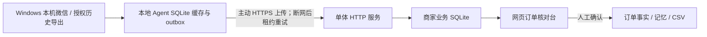

# 微信群 AI 接单助手：历史消息手动导入与规则解析原型

> 当前交付定位：历史消息手动导入与规则解析原型。代码现已包含本地 Agent 事件到商家订单库的主动上传桥接，以及可选 OpenAI-compatible 模型适配器；这不代表已经通过真实微信采集或真实模型服务验证，也不应作为已达到商业试用标准的说明。

> **面向非技术商户的交付形态（网页登录验证 + 本地订单软件 + 云端网关 + OpenCode 执行后端）已另行实现，见 [`product-gateway.md`](product-gateway.md)。**
> 本文描述的是其下层的单机原型业务 API，两者的关系是：**本地的订单、客户记忆、商品资料、审核界面与导出全部保留在商家 Windows PC；云端只新增“登录验证 + 解析任务”两项能力，且只返回解析建议，不直接写入本地正式订单。**
> 已核实的 OpenCode 事实与**尚未验证**清单见 [`opencode-verification.md`](opencode-verification.md)。

## 当前可用架构



业务库是独立 SQLite 文件和单体服务进程。Agent 通过主动连接上传业务事件，本地业务 outbox 独立重试；服务端按已绑定设备和群授权接收，并将消息幂等写入商家订单库。工作台仍可手动导入 JSON。消息进入订单库后，需人工绑定未识别客户并触发解析。此集成在本地自动化/HTTP 测试中验证，真实 Windows 微信账号、消息覆盖和生产网络尚未验证。

## 分阶段计划与验收

| 阶段 | 范围 | 验收 |
| --- | --- | --- |
| P0 核实现状 | 采集、消息库、重试、云同步及监听边界 | 确认代码路径及未实测能力；完成 |
| P1 业务数据 | 租户、用户/角色、设备、套餐、客户、商品、消息、订单、证据、记忆、审计迁移 | 两个租户数据不可互见；重复导入/解析不重复建单 |
| P2 审核闭环 | 商家开通、客户/商品、JSON 导入、演示解析、人工修订/确认、简写引用、工作台 | 从导入到确认全程可追溯，改单留版本 |
| P3 接入与模型验证 | Agent 业务上传、设备/群授权、可选结构化模型适配器 | HTTP/重试/幂等自动化验证；真实采集与模型端点待配置实测 |
| P4 商业运营 | 权限管理、套餐扣额、真机试运行、备份恢复 | 核心订单效果稳定后再做影子运行和手动收费交付 |

演示解析默认为确定性规则适配器，不调用模型、不计 AI 额度。可配置 OpenAI-compatible Chat Completions 端点启用结构化模型解析；模型端点用固定 schema、证据和商家目录校验，但当前没有可用真实密钥，未验证真实模型的理解质量。人工确认后才形成订单事实和可引用记忆。

计数口径：解析结果里的 `order_action_messages`、`manual_review_messages`、`ignored_messages` 和 `duplicate_messages` 是**本轮被处理的消息动作数**，不是订单数量；例如追加消息会作用于已有草稿，仍计一条订单处理消息。`order_versions_in_batch` 是批次关联的订单版本记录数；`draft_orders_in_batch` 和 `review_orders_in_batch` 是其中当前处于对应状态的版本记录数。工作台“待确认草稿/待人工核对订单”按订单版本状态统计，审核任务挂在订单版本上，证据来自一条或多条消息。四个计数含义不同，不应相加当作订单总量。

工作台导入反馈会同时显示本轮消息处理数和批次订单版本状态。模型解析失败单独计入失败任务，审核卡显示失败原因并可重试；商家创建时确定解析模式，模型配置须三项齐全，模型模式遇到超时、非法响应或配置缺失会保持失败/待处理状态，不会切换到规则解析冒充模型成功。

## 启动

需要 Python 3.10+；本仓库当前开发环境使用 `.venv`。无需新依赖。

PowerShell：

```powershell
# 从仓库根目录运行后续命令。
$env:PYTHONPATH = "src"
$env:WECHAT_AI_CLOUD_TOKEN = "change-agent-token"
$env:WECHAT_AI_CONSOLE_TOKEN = "change-console-token"
$env:WECHAT_AI_BUSINESS_DB = "orders.db"
# 可选真实模型。留空时使用 demo 规则适配器。
# $env:WECHAT_AI_MODEL_BASE_URL = "https://api.example.com/v1"
# $env:WECHAT_AI_MODEL_API_KEY = ""
# $env:WECHAT_AI_MODEL_NAME = ""
..\.venv\Scripts\python.exe -m wechat_ai_assistant.cloud_server --host 127.0.0.1 --port 8787 --token $env:WECHAT_AI_CLOUD_TOKEN --console-token $env:WECHAT_AI_CONSOLE_TOKEN --business-db $env:WECHAT_AI_BUSINESS_DB
```

在 `http://127.0.0.1:8787/console` 创建试用商家并保存一次性显示的工作台 token。向经授权的商家数据库导入客户和商品后，即可使用工作台。业务库表结构在 `OrderStore` 初始化时通过 SQLite `CREATE TABLE IF NOT EXISTS` 迁移，版本号表为 `schema_version`。尚未提供跨版本升级/回滚框架。

若要把本地 Agent 事件桥接至订单库：先用商家 token 在工作台创建设备并授权群，安全保存一次性显示的设备 token；Windows 上设置 `.env.example` 中 `WECHAT_AI_DEVICE_TOKEN`、`WECHAT_AI_CLOUD_URL`、`WECHAT_AI_AGENT_ID`、`WECHAT_AI_ACCOUNT_ID`、`WECHAT_AI_GROUP`，再运行 `wechat_ai_assistant-agent`（或源码开发时运行 `python -m wechat_ai_assistant.agent_cli`）。Agent 的新事件会主动上传、授权校验、幂等写入并触发解析。设备 token 仅允许上传已授权账号与群。该软件流程的自动化接口已测试；实际群历史来源依然依赖本机已登录微信和现有 UI 导出，尚未真机验证。

装载明确标记的合成演示数据：

```powershell
$env:PYTHONPATH = "src"
$env:WECHAT_AI_BUSINESS_DB = "orders.db"
..\.venv\Scripts\python.exe examples\demo_order_agent.py
```

若首次开通商家后再运行演示装载器，会另外创建合成租户；可在控制台用其 token 查看。脚本输出的 demo token 只显示一次。

### 完整演示路径

1. 首次打开控制台注册商家，留存 token。
2. 建客户并配置群昵称别名，再建商品 SKU、单位和当前单价。
3. 在“导入消息 JSON”输入授权导出/演示消息；提供 `sender`、`content`、`sent_at`、`kind`、`source_id`。用不同 source_id 的重复正文代表真实重复发言；相同稳定 source_id 重导只新增零条。
4. 点“导入并生成草稿”。逐条查看原文、客户、商品、数量、价格和引用历史。歧义、未知客户和非文字内容进入待核对。
5. 确认前应人工核实；确认才写入已确认订单和订单记忆。程序不自动发货、扣库存或认定到账。
6. 导出已确认 CSV。再次导入同客户的“老样子，明天送”，演示解析会引用最近已确认订单并重新读取当前 SKU 价格。

### API

- `POST /api/v1/business/register`：创建试用商家及老板 token。
- Bearer 商家 token：`/api/v1/business/dashboard|customers|products|imports|orders|export`。
- `POST /api/v1/business/customers|products|imports|parse|devices|bind-customer`。
- 设备 Bearer token + `X-Agent-Id`：`POST /api/v1/agent/business-events`；只接受设备已授权的账号/群。
- `POST /api/v1/business/orders/{order_id}/correct|confirm`。
- 商家身份只从服务端 token 解析；请求体没有 tenant 覆盖能力。

这是一套单机试用 API，不是可直接接公网的 SaaS 身份系统。远程使用必须 HTTPS、密钥轮换、速率限制、审计保留和备份恢复方案。

## 真实微信历史导入步骤

1. 在专用 Windows 电脑登录获授权的商家微信，确认目标群和账号；不要把登录态交给云端。
2. 运行项目现有 `Messages.dump_chat_history(friend=群名, number=N, close_weixin=...)` 导出前，记录电脑、微信版本、起止时间及授权范围。该路径打开聊天/历史窗口并滚动 UI，可能影响前台；安排维护时段，先用少量样本。
3. 方法返回字段因本地实际版本检查，包括 `消息发送人`、`消息内容`、`消息类型`、`消息发送时间`。转换成工作台 JSON：`sender`、`content`、`kind`、`sent_at`；stable source ID 若来源没有提供请不要自行伪造，用时间/发送人/内容做候选对齐并标记低可信。
4. 将导出文件按已核实覆盖范围分批导入；记录最早/最晚发送时间及可见边界。UI 导出上限与 PC 历史可见范围必须现场测量。
5. 抽样逐条与微信界面对照，特别核对成员同名、改名、引用、接龙、图片/语音和相同正文。只有文字会进规则解析；其他类型保留在待处理队列。
6. 本地 Agent 已有 SQLite WAL、消息缓存、常规上传 outbox、独立业务上传 outbox、租约/退避重试和主动云端连接。业务事件可通过设备授权 API 写入商家消息库，上传成功后由工作台触发订单解析；这是软件集成测试通过，不等于微信消息来源和覆盖范围通过真机验证。

不在真机验证前宣称 500 人群完整采集、分页断点、后台不抢焦点、锁屏/RDP 断开支持或 AI 准确率。

## 功能状态与限制

| 能力 | 状态 |
| --- | --- |
| 本机微信 UIA 历史导出 | 已有实现；会操作 UI，真实范围未验证 |
| 本地持久化/断网 outbox/重试/主动同步 | Agent 代码与自动化测试覆盖；真实断网/重启现场演练未做 |
| 商家注册与老板/操作员字段 | 有商家注册；老板角色和套餐数据表；成员邀请/角色管理界面缺失 |
| 设备绑定/吊销 | 设备创建、群授权和事件上传 API/工作台流程具备；撤销与重新授权管理仍需补充 |
| 商家/客户/商品隔离 | 商家业务 API 服务端 token 解析，订单查询加租户过滤；文件/对象存储隔离未涉及 |
| 历史消息导入批次及范围 | JSON 手动导入具备；不直接调用微信分页读取 |
| 解析 | 演示规则适配器可用；可选结构化 LLM 适配器已有代码和桩测试，失败显式留任务、可重试且不会自动降级；真实服务、精度与隐私配置未验证 |
| 重叠批次消息 | 来源 ID 弱且发送人、精确发送时刻（±0.5 秒）、正文、类型均匹配时，建立候选并暂停建单，人工裁决重复/独立；邻接序列、时间精度变化、改名等其他跨批次情况未验证，批次缺口会提示 |
| 草稿/审阅/确认/引用证据/记忆/审计 | SQLite 业务层具备基础版本化确认闭环 |
| 改量/取消/纠错 UI | 版本更正/变更确认/差异展示初步具备；复杂多轮修改仍需人工核对 |
| Agent 业务消息 | 设备授权事件主动上传、服务器端租户绑定、群校验、幂等消息写入及新事件触发解析；模拟 HTTP 路由覆盖，真实 Agent→微信→云端未验证 |
| 询价、跟单、跨客户多轮话题 | 未支持或需人工核对 |
| 额度计费/重试不重复扣费 | 按解析任务记录模型用量并在重放时复用已保存结果；套餐扣额和真实供应商账单对账尚未完成 |
| 汇总导出 | 已确认订单 CSV；备货汇总表仍需完善 |
| 图像/语音 | 进入待核对，不静默丢弃；OCR/ASR 未实现 |
| 500 人容量、真实 LLM、支付 | 未实测/未接入 |
| 实时后台监听 | 实验功能；LocalAgent 每轮重开窗口的焦点风险，默认不用于业务闭环 |

### 测试

```powershell
$env:PYTHONPATH = "src"
.\.venv\Scripts\python.exe -m unittest discover -s tests -v
```

当前测试验证 65 个用例，不能等同真实微信、云生产环境或真实模型精度验收。

产品网关与 Windows 客户端另有一组测试（浏览器验证到自动登录、授权码滥用、令牌轮换、跨商家隔离、幂等与额度并发、适配器失败与重启恢复、会话清理与备份恢复、故障不影响本地订单）：

```powershell
$env:PYTHONPATH = "src"
.\.venv\Scripts\python.exe -m unittest tests.test_product_gateway tests.test_client_login -v
```

全量用例数与本地端到端演练：

```powershell
.\.venv\Scripts\python.exe -m unittest discover -s tests
.\.venv\Scripts\python.exe examples\smoke_gateway.py   # 真实进程走完整商户流程
```

## 后续优先事项

1. 在商家获授权的真实群跑历史导入，核对覆盖范围、重复重启上传和同客户“老样子”回链，记录漏单/错单率。
2. 配置真实模型端点，在脱敏且获准的数据上按时间切分留出集评估证据正确率、客户归属和订单差异；检查失败/重放用量账。
3. 继续补强多条消息合单、目标订单消歧、导出备货汇总、设备撤销与权限管理。
4. 影子运行按 [`pilot-validation.md`](pilot-validation.md) 执行；本地文档仅是计划模板，不代表已取得商户授权或已开展试点。不自动联系客户、不自动发送群消息。
5. 定义 SQLite 在线备份、恢复演练、停订只读/导出、数据保留和删除策略，再推进套餐额度及运营后台。
6. 商业分发前核查许可证：根目录 `LICENSE` 是 LGPL-2.1，`src/pyproject.toml` 与 `src/setup.py` 写 `LGPL`，classifier 写 LGPLv3。保留现状并解决前先不要作商业兼容性结论；不改第三方授权文本。
